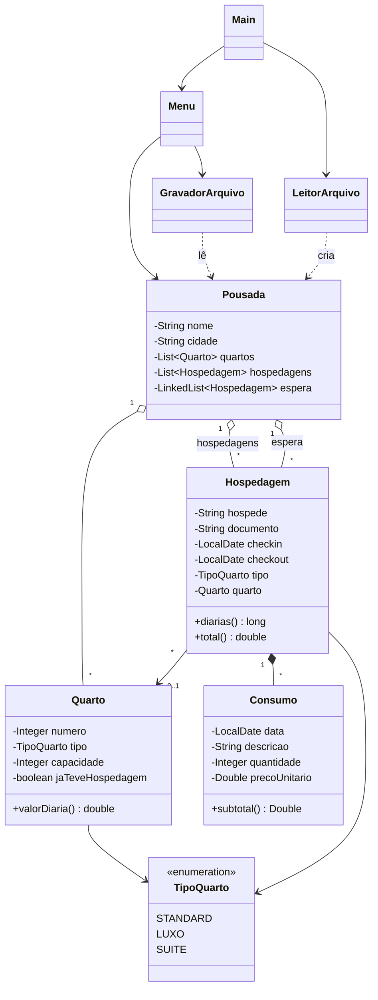

# Documentação do Funcionamento

## 1. Visão geral

O sistema é uma aplicação de console organizada em camadas simples:

- **Interface**: `Main` (ponto de entrada) e `Menu` (interação com o usuário)
- **Domínio**: `Pousada`, `Quarto`, `TipoQuarto`, `Hospedagem`, `Consumo`
- **Persistência**: `LeitorArquivo` e `GravadorArquivo`
- **Apoio**: `GeradorMassa` (gera arquivo de teste)

`Pousada` é a classe central: concentra a lista de quartos, as hospedagens confirmadas e a fila de espera, e aplica as regras de negócio. `Menu` apenas coleta dados, valida entradas e delega.

## 2. Classes

| Classe | Responsabilidade |
|---|---|
| `Main` | Carrega `dados/pousada.txt` se existir (senão cria "Pousada FACSI", Marabá) e inicia o `Menu`. |
| `Menu` | Menus, leitura e validação de entradas, listagens, consulta de detalhes, emissão de conta, mapa de ocupação, relatórios e gravação em `saidas/`. |
| `Pousada` | Guarda `quartos`, `hospedagens` e `espera`. Cadastra/remove quartos, registra e cancela hospedagens, encontra quarto livre, gera o fechamento mensal. |
| `Quarto` | Número, tipo, capacidade e a marca `jaTeveHospedagem`. Calcula o valor da diária pelo tipo. |
| `TipoQuarto` | Enum: `STANDARD`, `LUXO`, `SUITE`. |
| `Hospedagem` | Hóspede, documento, check-in, checkout, tipo desejado, quarto atribuído e lista de consumos. Calcula diárias, totais, taxa de serviço e noites em um mês. |
| `Consumo` | Data, descrição, quantidade e preço unitário, com validação nos setters. Calcula o subtotal. |
| `LeitorArquivo` | Lê o arquivo de dados, valida linha a linha e reconstrói a `Pousada`. |
| `GravadorArquivo` | Escreve a `Pousada` no formato de texto. |
| `GeradorMassa` | Programa à parte que gera `dados/grande.txt` com dados aleatórios reproduzíveis (`Random(10)`). |
| `TestesPousada` | Programa de testes automatizados (sem biblioteca externa): verifica regras, cálculos, arquivos e menu. |

## 3. Relacionamentos



Em palavras:

- **Pousada tem muitos Quartos** (agregação). Um quarto existe independentemente das hospedagens.
- **Hospedagem referencia um Quarto**. Enquanto está na lista de espera, `quarto == null`; ao ser confirmada, recebe um quarto do tipo solicitado.
- **Hospedagem é composta por Consumos** (composição): os consumos pertencem à hospedagem.
- A mesma classe `Hospedagem` pode estar em uma de duas coleções da `Pousada`: `hospedagens` (confirmada) ou `espera` (aguardando).
- `Hospedagem.tipo` é o tipo **desejado**; `Hospedagem.quarto.tipo` é o tipo do quarto efetivamente ocupado (são iguais ao confirmar).

## 4. Regras de negócio

### Quartos
- Número obrigatório, maior que zero e **único**.
- Tipo obrigatório; capacidade obrigatória e maior que zero.
- A lista de quartos é mantida **ordenada por número** (inserção ordenada em `adicionarQuarto`).
- Um quarto que **já teve hospedagem** (`jaTeveHospedagem = true`) **não pode ser removido**. A marca é ativada ao confirmar, promover da espera ou restaurar do arquivo uma hospedagem naquele quarto.

### Diárias e valores
| Tipo | Diária |
|---|---|
| STANDARD | R$ 180,00 |
| LUXO | R$ 260,00 |
| SUITE | R$ 390,00 |

- Nº de diárias = dias entre check-in e checkout (`ChronoUnit.DAYS`). O dia do checkout **não** é cobrado.
- `total = diárias × valor da diária + total de consumos + taxa de serviço`.
- **Taxa de serviço = 10% do total de consumos** (não incide sobre as diárias).
- Só é possível calcular o total de uma hospedagem que já tenha quarto.

### Hospedagens
- Checkout deve ser estritamente posterior ao check-in.
- No menu, o check-in não pode ser anterior à data atual.
- **Conflito de datas**: um quarto está indisponível para `[entrada, saída)` se existe hospedagem nele com `entrada < checkout_existente` e `checkin_existente < saída`. Assim, um hóspede pode entrar no mesmo dia em que o anterior sai.
- Ao registrar, o sistema escolhe o **primeiro quarto livre do tipo pedido** (menor número, pois a lista é ordenada).
- Uma hospedagem já registrada, na espera, ou que já possua quarto não pode ser registrada novamente.

### Lista de espera (política FIFO)
- Sem quarto livre do tipo, a hospedagem vai para o **fim** da fila.
- Ao **cancelar** uma hospedagem, percorre-se a fila **do início ao fim**: a primeira candidata com o mesmo tipo do quarto liberado e sem conflito no período é promovida e removida da fila. O `Menu` informa o hóspede promovido e o quarto.
- Apenas uma candidata é promovida por cancelamento.

### Consumos
- Data e descrição obrigatórias; quantidade > 0; preço ≥ 0.
- A data do consumo precisa estar entre check-in e checkout (inclusive), tanto na leitura do arquivo (`LeitorArquivo`) quanto no lançamento pelo menu (`Menu.adicionarConsumo`). Assim, nenhum consumo aceito no menu é descartado ao recarregar os dados.

### Fechamento mensal
- Entram as hospedagens cujo **mês/ano de checkout** coincide com o período pedido, ordenadas por checkout.
- Receita total e por tipo usam `Hospedagem.total()` (diárias + consumos + taxa).
- **Ocupação (%)** = soma das noites no mês de todas as hospedagens ÷ (nº de quartos × dias do mês) × 100. As noites no mês são calculadas pela interseção entre a estadia e o mês, então estadias que atravessam meses são divididas corretamente.
- O relatório é exibido e salvo em `saidas/fechamento_MM_AAAA.txt`.

## 5. Persistência (formato do arquivo)

Arquivo `dados/pousada.txt`, texto com campos separados por `;`:

```
Pousada FACSI;Maraba
QUARTOS;2
101;STANDARD;2
201;LUXO;3
HOSPEDAGENS;1
Maria Silva;12345678900;201;20/12/2026;23/12/2026;1
21/12/2026;Jantar regional;2;55.00
```

- Linha 1: `nome;cidade`.
- Seção `QUARTOS;n` seguida de `n` linhas `numero;tipo;capacidade`.
- Seção `HOSPEDAGENS;n`. Cada hospedagem tem uma linha `hóspede;documento;quarto;checkin;checkout;qtdConsumos` seguida de `qtdConsumos` linhas `data;descrição;quantidade;preço`.
- Datas em `dd/MM/aaaa`; preços com ponto decimal.
- O leitor é **tolerante**: linhas inválidas (campos faltando, datas ou números inválidos, quarto inexistente, sobreposição de datas etc.) são ignoradas com a mensagem `Linha N ignorada (motivo)`, e o carregamento continua.
- A lista de espera **não é persistida**.

## 6. `ArrayList` x `LinkedList`

| Coleção | Estrutura | Motivo da escolha |
|---|---|---|
| `quartos` | `ArrayList<Quarto>` | A pousada tem poucos quartos, cadastrados raramente, mas consultados o tempo todo (listagens, busca de quarto livre, mapa de ocupação, ocupação mensal). O `ArrayList` tem acesso por índice em O(1) e percorre a memória de forma contígua, o que favorece essas leituras. O custo de inserir no meio (necessário para manter a ordem por número) é O(n), irrelevante para dezenas de quartos. |
| `hospedagens` | `ArrayList<Hospedagem>` | Predominam inserções no fim (`add`) e varreduras completas (conflito de datas, fechamento, busca por documento). Ambas são eficientes no `ArrayList`. Cancelamentos são pouco frequentes, e o custo O(n) da remoção é aceitável. |
| `espera` | `LinkedList<Hospedagem>` | Representa uma **fila**: entra pelo fim (`addLast`, O(1)) e é atendida do início, na ordem de chegada. A `LinkedList` implementa `Deque`, expressando bem essa intenção, e a remoção de um elemento no meio (promoção de quem não é o primeiro) não exige deslocar os demais elementos, ao contrário do `ArrayList`. |

Observação técnica: em `cancelarHospedagem` a fila é percorrida com `espera.get(i)`, que na `LinkedList` é O(n) por chamada. Para filas pequenas isso não importa; em uma evolução, o ideal é percorrer com `Iterator` e remover com `iterator.remove()`, aproveitando de fato a vantagem da lista encadeada.

## 7. Tratamento de erros

- Regras de domínio violadas lançam `IllegalArgumentException` / `IllegalStateException`, capturadas no `Menu` e exibidas ao usuário (cadastro de quarto, lançamento de consumo, remoção de quarto).
- Entradas numéricas inválidas no menu principal geram a mensagem "Opção inválida" e retornam ao menu; nos submenus, "Digite um número válido!".
- Datas digitadas são validadas em laço (o sistema repete a pergunta até receber uma data válida).
- Falhas de leitura/gravação de arquivos exibem mensagem e não derrubam o programa. Um arquivo com linhas inválidas, inclusive quartos com número inválido referenciados por hospedagens, é carregado sem derrubar o sistema (as linhas ruins são ignoradas e reportadas).

### 7.1 Testes automatizados

A classe `TestesPousada` (sem bibliotecas externas) executa 181 verificações e retorna código de saída 0 se todas passarem. Cobre `Quarto`, `Consumo`, `Hospedagem`, a `Pousada` (reservas, conflito de datas, lista de espera FIFO, fechamento), a ida e volta `GravadorArquivo`/`LeitorArquivo`, arquivos com erros, o `GeradorMassa` e o `Menu` com entradas digitadas simuladas. Veja [TESTES.md](TESTES.md).

## 8. Limitações conhecidas

Pontos que permanecem no código e que a equipe deve ter em mente (úteis para evolução ou para justificar em apresentação):

1. **A lista de espera não é salva** no arquivo de dados; ao reiniciar, ela se perde.
2. **Hóspedes na espera não são localizados por documento**: consulta (opção 2), busca (opção 7), cancelamento e emissão de conta pesquisam apenas as hospedagens confirmadas. Quem está na espera só aparece no relatório 9.2 e não pode ser cancelado individualmente.
3. A opção 7 e a opção 2 mostram dados parecidos; a 7 é um resumo e a 2 é a ficha completa.
4. `Pousada` possui um atributo `jaTeveHospedagem` (com getter/setter) que não é usado; só `Quarto` precisa dele.
5. Alguns `Integer.parseInt` e `Double.parseDouble` do `Menu` (cadastro de quarto, consumo, remoções, tipo de quarto) não têm tratamento local: uma entrada não numérica cancela a operação e retorna ao menu com a mensagem genérica "Opção inválida" (o programa não fecha; isso é coberto pelos testes).
6. Documentos duplicados: as buscas por documento retornam a primeira hospedagem encontrada.
7. A taxa de ocupação do fechamento usa a quantidade **atual** de quartos, então um quarto cadastrado depois altera o percentual de meses passados.
8. Os valores monetários usam o formato numérico do sistema operacional (`R$ 901,00` em português, `R$ 901.00` em configuração inglesa); os testes comparam usando o mesmo formato para funcionar em qualquer computador.

### Correções feitas a partir dos testes

| Problema encontrado | Correção |
|---|---|
| Lançar consumo com quantidade 0, preço negativo ou descrição em branco **fechava o programa** (exceção não tratada em `Menu.adicionarConsumo`). | A exceção é capturada e o sistema mostra `Não foi possível adicionar o consumo: ...`. |
| O menu aceitava consumo com data fora da estadia, mas o `LeitorArquivo` descartava esse consumo ao recarregar (perda de dado). | `Menu.adicionarConsumo` agora exige data entre check-in e checkout, como o leitor. |
| Quarto com número inválido no arquivo (ex.: `0`) entrava na lista interna do leitor; uma hospedagem apontando para ele **derrubava o carregamento**. | `LeitorArquivo` só registra o quarto lido depois de a `Pousada` aceitá-lo. |
| Salvar falhava se a pasta `dados/` não existisse. | `GravadorArquivo` cria a pasta de destino quando necessário. |
| `Pousada.jaTeveHospedagem` não é usado. | Mantido sem alteração (não afeta o funcionamento). |
